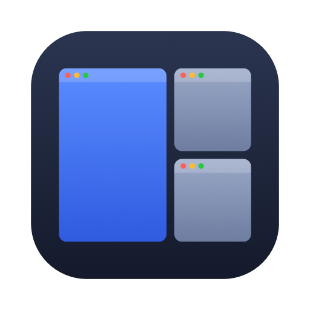
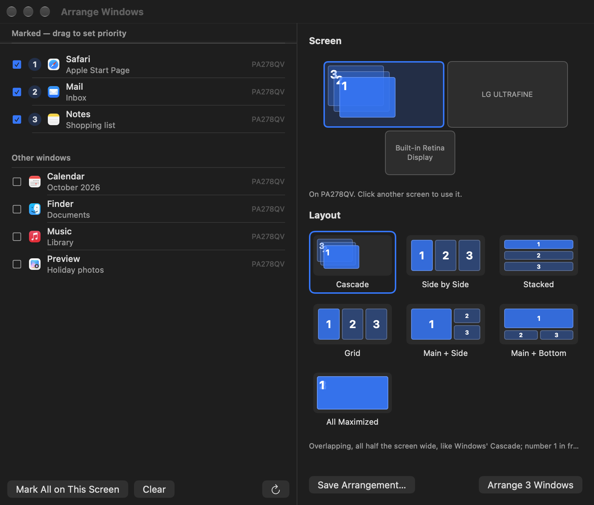
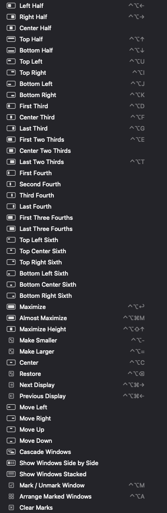
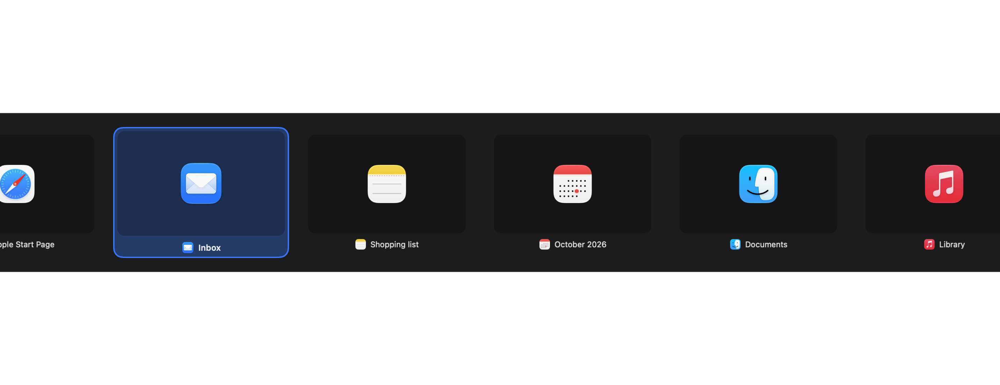

<p align="center"></p>

<h1 align="center">Elrange</h1>

<p align="center"><b>Arrange windows on the Mac: everything Rectangle does, plus Windows-style arranging.</b><br>
Keyboard shortcuts, drag to snap, cascade, marked windows in priority order, and a scroll-wheel window switcher.</p>

<p align="center">
  <a href="https://github.com/eladitz/elrange/releases/latest/download/Elrange.dmg"><b>Download for Mac</b></a> ·
  <a href="https://ai.itzkin.com/elrange.html">Website</a> ·
  <a href="https://ko-fi.com/eladitzkin">Support on Ko-fi ☕</a>
</p>

<p align="center"></p>

Free and open source. Apple Silicon and Intel, macOS 14 Sonoma or later. Lives in the menu bar.

## Rectangle's features

Rectangle's default shortcuts, all changeable (click a shortcut in the menu, or in Settings):

| | |
|---|---|
| Halves | ⌃⌥← ⌃⌥→ ⌃⌥↑ ⌃⌥↓ (press again: ½ → ⅔ → ⅓) |
| Quarters | ⌃⌥U ⌃⌥I ⌃⌥J ⌃⌥K |
| Thirds | ⌃⌥D ⌃⌥F ⌃⌥G, two thirds ⌃⌥E ⌃⌥T |
| Maximize | ⌃⌥↩, maximize height ⌃⌥⇧↑, almost maximize |
| Center, smaller, larger | ⌃⌥C, ⌃⌥−, ⌃⌥= |
| Restore | ⌃⌥⌫ (back to the size before Elrange moved it) |
| Displays | ⌃⌥⌘→ ⌃⌥⌘← |
| Also | fourths, sixths, center half, center two thirds, move to an edge |

- **Drag to snap:** top edge maximizes, sides make halves, corners quarters, the bottom edge thirds. A preview shows where the window will land, and dragging a snapped window away gives back its old size.
- **Gaps** between windows, **apps to ignore**, open at login.

<p align="center"></p>

## Windows-style arranging

- **Cascade, Side by Side, Stacked** for the windows on the screen you're working on. Cascaded windows are all the same size: half the screen wide.
- **Mark windows** with ⌃⌥M (or tick them in **Arrange Windows…**), drag them into priority order, pick a screen on the map and a layout (Cascade, Side by Side, Stacked, Grid, Main + Side, Main + Bottom, All Maximized), and ⌃⌥A arranges them. Number 1 gets the biggest place and ends on top.
- **Saved arrangements:** save where every window is on every screen under a name ("Coding", "Calls") and bring it back from the menu.

## Window switcher

Hold **⌃⌥** and turn the mouse wheel: previews of every open window, across all screens. Let go to bring the highlighted one forward; Esc cancels. The keys are your choice in Settings.

<p align="center"></p>

## Install

Download [Elrange.dmg](https://github.com/eladitz/elrange/releases/latest/download/Elrange.dmg), open it and drag Elrange into Applications. The first time, macOS may say it can't check the app: open **System Settings ▸ Privacy & Security** and click **Open Anyway**.

Elrange then asks for two permissions, once:
- **Accessibility**, to move other apps' windows (it doesn't read what's in them).
- **Screen Recording**, only for the switcher's live previews; without it you see app icons.

Elrange checks for new versions once a day.

## Build it yourself

Needs the Command Line Tools (`xcode-select --install`), not Xcode.

```bash
./build.sh      # build/Elrange.app
./package.sh    # build/Elrange.dmg
```

| File | What's in it |
|---|---|
| `Sources/App.swift` | Menu bar app, menu, permission window |
| `Sources/AX.swift` | Reading and moving windows (Accessibility) |
| `Sources/Layouts.swift` | Where each action and layout puts windows |
| `Sources/Manager.swift` | Running actions, restore, marks, saved arrangements |
| `Sources/Hotkeys.swift` | Global shortcuts and the recorder |
| `Sources/Snap.swift` | Drag to snap, its preview, the popups |
| `Sources/Switcher.swift` | The scroll-wheel window switcher |
| `Sources/ArrangeWindow.swift` | Arrange Windows |
| `Sources/MenuRow.swift` | Menu rows: pictures, click-to-change shortcuts |
| `Sources/Settings.swift` | Settings |

## Support

Elrange is free and made by one person. If it tidies up your screens, a coffee on **[Ko-fi](https://ko-fi.com/eladitzkin)** keeps it going.

MIT licensed. Inspired by [Rectangle](https://github.com/rxhanson/Rectangle).
